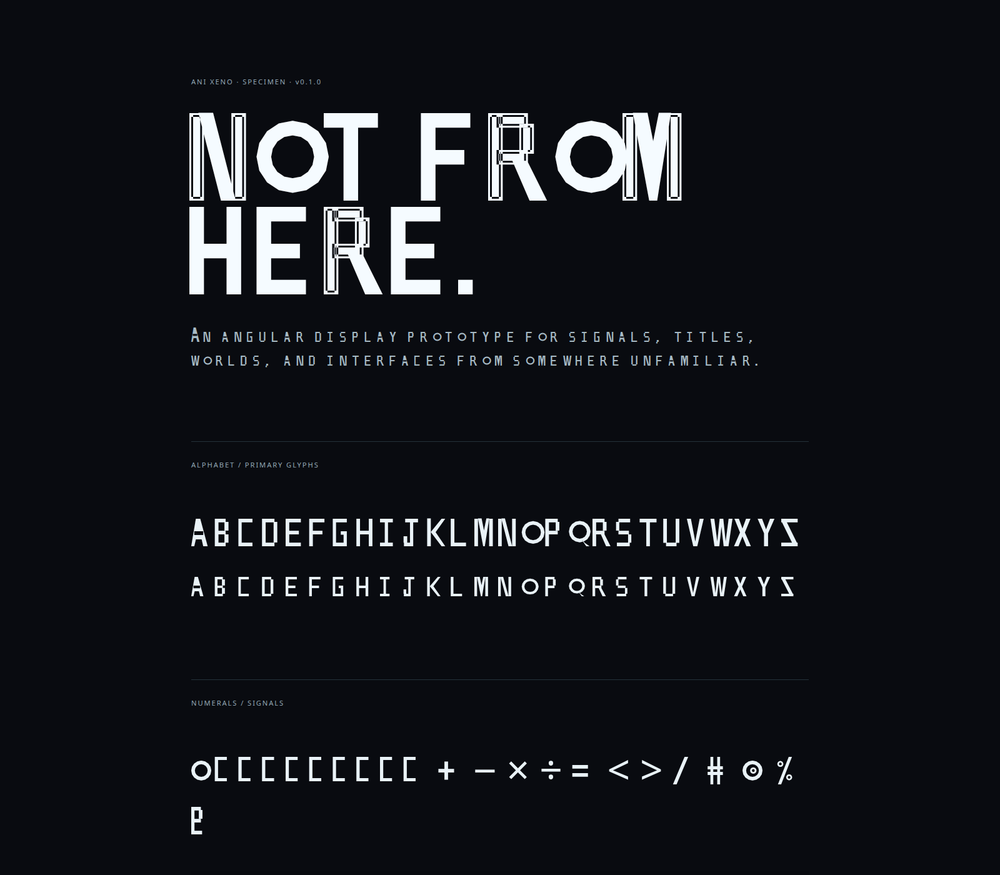

# Ani Xeno



**Ani Xeno** is an original alien-inspired display typeface by **Aniruddha Salve**. It is designed for science-fiction titles, game interfaces, posters, album artwork, logos, and short expressive text.

> A type system from somewhere unfamiliar.

## Current release

**Version:** `0.1.0`  
**Style:** Regular display prototype  
**Coverage:** Basic Latin, numerals, punctuation, and interface symbols  
**License:** SIL Open Font License 1.1

Ani Xeno is intentionally unusual, but it is built from a consistent system: angular terminals, hard rhythm, asymmetric pressure, strong silhouettes, and repeated alien construction logic. It is a display typeface, not a paragraph or small mobile UI font.

## Download

- [Ani Xeno TTF](fonts/ttf/AniXeno-Regular.ttf)
- [Ani Xeno OTF](fonts/otf/AniXeno-Regular.otf)
- [Ani Xeno WOFF](fonts/webfonts/AniXeno-Regular.woff)
- [Ani Xeno WOFF2](fonts/webfonts/AniXeno-Regular.woff2)
- [Ani Xeno v0.1.0 release ZIP](https://github.com/aniruddhasalve/ani-xeno/releases/download/v0.1.0/AniXeno-v0.1.0.zip)

## Recommended use

Use Ani Xeno for short titles, labels, game menus, posters, sci-fi branding, logos, and experimental interfaces. For long reading, mobile body copy, and general product UI, use Ani Uni instead.

## Specimen

Open the [alien specimen](specimen/index.html) to review the alphabet, numerals, signal symbols, title treatments, and fictional transmission panel.

## Evidence

The `evidence/` folder stores the rendered specimen, validation report, metadata dump, SHA-256 checksums, and release package evidence. Run the validator from the project root:

```bash
python3 tests/validate_font.py
```

## Author

**Aniruddha Salve**  
`salveaniruddha180@gmail.com`

Copyright © 2026 Aniruddha Salve.

## License

Ani Xeno is released under the [SIL Open Font License 1.1](LICENSE.txt).
